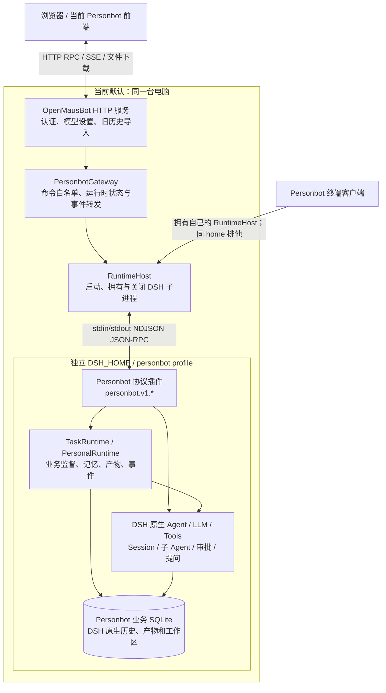

# Personbot 当前架构、DSH 接入与手机兼容性

核对日期：2026-11-06。依据 `personbot/dsh-foundation` 当前工作区源码；“当前实现”“上游能力”和“建议设计”分别标明，避免把可扩展性当作已经交付的功能。

用户后续明确要求保留原界面，并优先直接使用官方 Super Agent 源码。当前实现事实仍以本文为准；后续整合方向以 [原界面、官方 Super Agent 与记忆/会话的整合边界](personbot-integration-boundaries.zh-CN.md) 为准。

## 1. 先明确三个结论

1. 当前是 **Personbot 管理的本机 DSH 子进程**。DSH 以锁定 npm 依赖提供，不要求用户预先运行 DSH，也不能直接填写现有 DSH 网关地址接入。
2. DSH 上游有插件体系和原生 API Gateway。当前 Personbot 还没有完整开放插件安装、持久配置及外部网关连接；这两项不能只靠增加设置输入框完成。
3. OpenMausBot 的手机浏览器/PWA 与原生手机 App 使用不同的入口和 API。浏览器可以复用同一前端与网页认证，原生 App 目前不能直接操作 Personbot 新会话。

## 2. 为什么 UI 变化这么大

本轮同时实施了执行底座替换与独立工作台。主模式在旧 `StoreProvider`、onboarding 和旧应用界面挂载前进入新的 `PersonbotProduct`，所以原来的联系人侧栏、原引擎设置和原远程连接设置没有出现在新工作台中。

选择独立界面的理由是避免旧执行入口与新执行底座混用，并为长期任务、记忆、产物和渠道提供直接入口。但 **替换为 DSH 不要求重新设计整个 UI**。原应用的视觉、导航、聊天呈现和设备连接入口可以继续使用；需要替换的是它们访问的执行与状态接口。

旧 `Application` 没有删除，显式回退仍可进入。然而，单纯恢复旧界面开关会同时恢复旧执行路径，不能当作“保留原 UI、使用新 DSH”的完成实现。要实现后者，需要让原界面的数据源和命令接到 Personbot，同时保持旧执行器关闭。

源码：

- [App 主模式选择](../src/App.tsx)
- [独立工作台](../src/components/personbot/PersonbotProduct.tsx)
- [主模式执行限制](../server/personbot-mode.ts)
- [旧界面数据与命令](../src/state/store.tsx)

## 3. 当前实际部署



图中的终端入口是另一种启动路径，不是已经附着到 App 运行时的客户端。App 与 CLI 不能同时启动并拥有同一个 home；当前没有 CLI 附着到现有网关的命令。

| 层 | 当前责任 | 主要实现 |
|---|---|---|
| 前端 | 会话、消息投影、审批、问题卡片、任务和设置 | `src/components/personbot/`、`src/lib/personbot-client.ts` |
| HTTP 服务 | 既有认证、owner/admin 检查、模型设置、旧历史读取和导入 | `server/routes/personbot*.ts` |
| Personbot 网关 | 允许的业务方法、懒启动、错误和事件转发 | `packages/personbot-gateway/` |
| 进程 Host | 精确拥有一个子进程、RPC 请求、超时、退出与清理 | `packages/personbot-runtime-host/` |
| DSH 内的业务插件 | Session 绑定、稳定命令、任务监督、个人能力和事件调度 | `packages/personbot-runtime-plugin/` 及其他 Personbot 包 |
| DSH 原生服务 | 模型与工具循环、原生历史、子 Agent、审批和执行树 | 锁定的 `@deepseek-ai/dsh-*` 依赖 |

当前使用 `@deepseek-ai/dsh@0.2.2-rc.1`。启动器生成专用 profile，组合 `dsh-base` 和 `dsh-sdk-app`，插入 Personbot 插件，再执行该依赖的 `lib/bin.js --profile personbot`。运行时位于独立 Node 子进程中，并非把完整 DSH 直接运行在浏览器或 HTTP 服务进程里。

自有协议插件替代上游 stdio JSON-RPC 服务；消息、审批、问题和任务经 `personbot.v1.*` 进入原生服务。这里没有第二套模型/工具推理循环。

浏览器窗口关闭时，只要 App 的 Node 服务仍在，任务可以继续运行。App 服务关闭时，会关闭其拥有的 DSH 子进程；当前并未实现独立于 App 服务生命周期的常驻 DSH 服务。

另一个需要明确的边界：当前 `personbot-supervisor` 提取了 Super Agent 原型的领域事务、Effects、Outbox 和 worker 机制，**没有直接加载整个上游 Super Agent 原型 bundle**。因此不能把当前实现描述为对完整官方 Super Agent 插件的无修改嵌入。

锁文件同时记录 npm 制品版本和研究源码 commit，但 `artifactCommitVerified` 为 `false`；本文没有把 npm 安装产物宣称为已逐字验证等同该研究 commit。

源码：[启动与 profile](../packages/personbot-runtime-plugin/src/launch.ts)、[进程 Host](../packages/personbot-runtime-host/src/index.ts)、[网关](../packages/personbot-gateway/src/index.ts)、[协议插件](../packages/personbot-runtime-plugin/src/index.ts)、[任务执行](../packages/personbot-runtime-plugin/src/tasks.ts)、[锁定与提取范围](../upstream/personbot-runtime.lock.json)。

## 4. “Personbot 网关”与“DSH 网关”不同

| 连接方式 | 当前状态 |
|---|---|
| 网页连接 Personbot HTTP 服务 | 已实现，使用 `/api/personbot/rpc` 与 `/api/personbot/events` |
| Personbot 启动并管理本机 DSH | 已实现，stdio JSON-RPC |
| 连接用户已经启动的普通 DSH 网关 | 未实现 |
| 从普通 DSH 网关自动取得 Personbot 任务、记忆、产物与验收语义 | 不成立，需要业务插件与对应协议 |
| 多个 Personbot 客户端连接同一个 Personbot HTTP 服务 | 服务端共享同一个运行时；远程地址、认证和设备访问仍需各自接线与验收 |
| App 与独立 CLI 共用相同 home 并各自启动 DSH | 排他锁拒绝，避免两个运行时同时修改同一份状态 |

DSH 原生 API Gateway 暴露的是其服务远程调用与事件流；当前 PersonbotGateway 暴露的是自有业务契约。两者的协议、会话身份和生命周期不能直接互换。

核对的上游实现包含 HTTP `/api` 和 WebSocket `/api/remote.mux`，并提供认证后的非浏览器连接入口。当前采用的 SDK profile 不启动该 Web 服务。因此，“上游有网关”与“本产品已接入网关”是两件分别需要验证的事。

接入普通 DSH 网关可以先获得它已有的原生能力，但不会自动存在我们定义的 `personbot.v1.tasks.*`、完成条件、人工验收、稳定导入回执和项目记忆语义。保留这些功能的远程节点，需要安装并启用 Personbot 业务插件，或增加等价的业务服务。

### 建议的双模式设计，尚未实现

```text
原界面 / 手机客户端
        ↓
Personbot 认证与业务 API
        ↓
统一 RuntimeConnection
        ├─ LocalManaged：启动并拥有本机 DSH
        └─ RemoteAttached：连接已有 DSH 网关
                            + Personbot 业务插件
```

两种连接共享 Session、输入、审批、Stop、Task 和快照契约。远程模式应先握手确认协议版本、业务能力、运行时身份和权限，再使用已有会话；断线不能被解释为任务已停止，重连也不能无条件重发结果未知的操作。

当前设置、旧历史导入计划和运行时业务文件默认使用同一个本机 home。远程接入必须重新明确这些数据的拥有者、远程项目路径、凭据所在节点以及产物读取方式。不能把本机的绝对目录直接当成远端同名目录。

普通远程客户端不能因为断开或退出而关闭整个共享 DSH 服务。`RuntimeHost` 目前拥有子进程且会关闭它，远程附着需要独立的连接关闭语义。

## 5. DSH 插件能否安装

**上游支持，当前 Personbot 的受支持产品流程尚未开放。**

上游插件管理使用 profile 的 `package.json`、`cordis.yml` / `cordis.patch.yml` 和 package/bundle 声明。当前 Personbot 自己也是 DSH 插件，说明组合机制确实被使用；但这不等于用户现在可以在 App 中自由安装插件。

当前有三个实际限制：

1. `prepareRuntime()` 每次启动都重写专用 profile 的 `package.json` 与 `cordis.patch.yml`。直接手改这些文件，不是能够长期保存的插件配置入口。
2. profile 禁用了 `tool-plugin-manager`、只读运行时检查工具 `tool-cordis` 和 HMR，未提供 App 的安装、启用、禁用、升级或回滚接口。基础组合中的 `plugin-manager` 与 `config-editor` 服务本身仍在，只是没有通过 Personbot 协议开放。
3. 为保持任务和调度只有一个拥有者，独立 schedule、goal 自动续轮等入口被关闭。增加同类插件需要决定谁拥有任务与计时，不能直接全部启用。

修改源码并把所需插件加入依赖和 profile，可以做定制集成。当前没有完成对任意第三方插件的生命周期、权限、协议和恢复兼容性保证。

上游更高优先级的 home patch 仍可覆盖生成的 profile；当前 profile 并非完全禁止自行配置。不过，Personbot 尚未提供配套的持久依赖声明、兼容检查与产品入口，不能把这条开发者覆盖路径称为已交付的插件管理。

建议开放持久的用户插件声明与配置覆盖层，由启动器合成 profile，而非覆盖用户配置；提供版本锁定、状态查看、停机安装、启动检查与失败回滚。模型 provider、工具、MCP 和领域能力可以优先接入；修改 Agent、Session、审批、调度或传输服务的插件，需要验证与 Personbot 业务契约是否一致。

源码：[profile 生成与禁用列表](../packages/personbot-runtime-plugin/src/launch.ts)、[当前运行时依赖](../packages/personbot-runtime-plugin/package.json)。

## 6. 原手机端能否复用

### 浏览器 / PWA

可以复用同一份前端、网页登录、配对和同源请求机制，手机不运行 DSH。DSH 及任务继续在服务器上执行，手机关闭不会等于任务停止。

当前已经验证响应式布局，**没有完成真实手机远程配对与重连的端到端验收**。还需要可达的服务地址、HTTPS 等受支持访问路径、合适的网页会话权限，以及主界面里的设备与配对入口。当前 `personbot:start` 提供的是本机回环地址，不能把电脑上的 `127.0.0.1` 复制到手机使用。

当前 Personbot 普通接口只接受 owner/admin；旧的 `--client` 配对权限不会自动取得这些接口的访问权。若要保留手机“仅聊天、审批、查看任务”的权限范围，需要新增相应的细粒度授权，不能仅为打通手机连接就默认赋予全部管理权限。

原工作台中的远程访问设置没有被放进新的 Personbot 导航，这属于本轮 UI 重构留下的入口缺口。已有认证代码没有因此变成已完成的手机产品流程。

参考：[手机 Web App 说明](phone-web-app.md)、[网页会话与配对](../src/lib/session.ts)、[手机配对入口](../src/lib/phone-pairing.ts)。

### 原生 iOS / Android 客户端

原生客户端有直接连接主服务与通过 companion sidecar 代理两条路径。主服务仍保留 `POST /api/pair` 和原生配对链接。两条路径原先都使用 `/api/bots`、`/api/threads`、`/api/events` 等旧业务契约；当前 Personbot 使用新的 Session、协议和事件接口。

主模式拒绝旧聊天与执行写接口，因此即使原生设备直接配对成功，也不能据此认为旧 App 可以读取或操作新的 Personbot 会话。走 companion 时还有额外限制：其默认拒绝的白名单未加入 `/api/personbot/*`。只增加路由白名单也不足以改变客户端的数据模型。

companion 是面向原生客户端的 API 代理，不提供网页静态资源；请求 `/` 返回 404，带 `Origin` 的请求也会被拒绝。手机浏览器/PWA 应连接提供完整前端、API 和事件流的主服务入口，不能用 companion 端口代替。

当前克隆仓库没有原生 iOS/Android 客户端工程，只有相关文档、配对服务与 companion 实现。要修改并发布原生客户端，还需要取得对应源码和构建条件。

可以继续复用配对、设备信任、撤销和传输基础设施。接下来有两条实现路径：

| 路径 | 适用情况 | 需要完成 |
|---|---|---|
| 修改手机客户端，使用 Personbot API | 可以维护手机 App 源码和发布流程 | 新会话、消息、任务、审批、问题、快照和断线恢复模型；设备级权限 |
| 服务端增加旧客户端协议兼容层 | 希望现有手机 App 继续支持基础聊天 | 将旧 bot/thread/message/事件映射到稳定 DSH Session，所有执行仍进入同一业务 API |

兼容层不能启动旧 Agent，也不能同时维护第二份模型上下文。旧的消息/审批/事件游标语义与新协议不同，需要明确转换；新的长期任务验收等功能，仍可能需要手机界面更新。

原项目还支持“手机 App 作为 Agent 工具”的独立能力；当前没有把那套旧设备 MCP 自动接入 DSH，不能与“手机作为客户端连接”混为一谈。

源码：[companion 白名单](../companion/src/routes.ts)、[代理与事件处理](../companion/src/proxy.ts)、[companion 边界](../companion/README.md)、[主服务原生配对](../server/index.ts)、[Personbot 接口与权限](../server/routes/personbot.ts)、[主模式旧接口拒绝](../server/personbot-mode.ts)。原生客户端与设备体系的上游说明见 [iOS companion 架构](ios-companion.md)；本仓库中的文档不代表手机 App 已接入 Personbot。

## 7. 后续优先级建议

保留原工作台呈现、设置和手机连接入口，优先将官方 Super Agent 源码适配为监督核心。先完成其部署前提和固定 DSH 版本的兼容验证，再在原 API、事件和记忆接口处整合；不继续把当前自有监督器当作官方核心必须服从的前提。具体责任与现有工作的取舍见 [整合边界](personbot-integration-boundaries.zh-CN.md)。

然后完善插件管理、本机/远程连接和手机端验收。所有客户端共享 DSH 原生执行能力，任务只由一套监督核心推进，长期记忆优先复用原服务。
