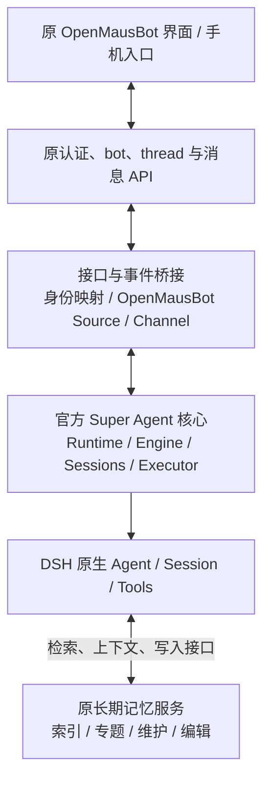

# 原界面、官方 Super Agent 与记忆/会话的整合边界

核对日期：2026-11-06。本文记录用户最新明确的约束、当前实现的实际取舍，以及据此修正的整合方向。后续方案尚未实施；本文不表示已经恢复原界面或加载官方 Super Agent。

## 1. 已明确的产品约束

- 保留原 OpenMausBot 的整体界面、导航、聊天交互、设置和手机连接设施。仅调整接入所必需的配置与状态呈现。
- 优先使用 DeepSeek 团队发布的 Super Agent 源码进行可追踪的二次开发，避免用自行重写的监督器替代其核心。
- 原产品已有能力先核对并复用；模型原生上下文、任务生命周期和长期记忆分别明确唯一负责方。
- 界面只需小改，不代表后台也只能小改。版本兼容、个人场景和客户端协议的适配可以在服务端完成。

## 2. 当前实现实际上做了什么

| 部分 | 当前实现 | 与最新方向的差异 |
|---|---|---|
| 界面 | 主模式绕过原 Application，挂载独立 PersonbotProduct | 应复用原界面 |
| 模型与工具循环 | 使用真实 DSH 原生 Agent | 这部分方向一致 |
| 任务监督 | 自建 personbot-supervisor，借鉴上游事务、Effects、Outbox 等机制 | 应改为官方 Super Agent 核心加明确的适配 |
| 长期记忆 | 新建 personal.sqlite，个人/项目记忆支持建议、确认、更正和遗忘 | 未复用原有记忆存储及维护链路 |
| 会话 | 新建产品 Session 绑定与投影，原生历史仍在 DSH | 原 UI 会话与原历史没有作为统一产品入口接回来 |

这些是实现选择，不是 DSH 强制要求。当前新路径没有删除原能力，但也没有自动继承它们。

依据：[界面分流](../src/App.tsx)、[上游机制借鉴范围](../packages/personbot-supervisor/THIRD_PARTY.md)、[集成锁文件](../upstream/personbot-runtime.lock.json)、[新记忆存储](../packages/personbot-personal/src/store.ts)、[新 Session 绑定](../packages/personbot-runtime-plugin/src/store.ts)。

## 3. 为什么之前没有直接使用完整官方源码

现有实现把个人多项目、人工验收、停止确认和不确定结果恢复等要求，放进自有的任务监督层处理。与此同时，绕开了上游单 GitHub 仓库的部署与渠道假设。这让新路径更容易按自定义协议闭环，却也形成了额外的监督、记忆和界面体系。

核对的上游源码确实有适配成本：

- README 将其定位为面向一个 GitHub 仓库的主动编码 Agent，并明确说明是研究原型。
- 启动检查要求配置仓库、GitHub CLI 身份和仓库写权限。只增加一个本地聊天 Source，仍不足以绕过这套部署前提。
- 主插件依赖 sessionController、sessionPersistence、workspaceRegistry、webServer 等服务；当前专用 SDK profile 不能被未经验证地当作完整运行环境。
- 上游研究版本面向 DSH 0.2.1-alpha.2 系列，Cordis peer 精确声明为 4.0.5-alpha.1；当前安装的是 DSH 0.2.2-rc.1、Cordis 4.1.0。需要验证并适配，不能宣称直接加载已经兼容。
- 官方 worker 工具、权限、任务结束和来源授权有自身语义；它们需要对齐个人助手场景，而不能与另一套监督器同时控制同一任务。

只读比对实际安装包后，官方使用的 sessionController 创建/恢复、Agent 输入、工具注册、权限设置和 WebServer 接口仍然存在；没有发现关键 API 已消失的已证实阻断。版本差异和服务装配不足是兼容工作，不能被表述为已经证明无法直接集成。

这些事实说明需要适配官方源码，**没有证明必须另写监督核心**。此前没有完成“保留官方核心、适配边界”的完整加载验证，不能把尚未验证的兼容问题当作无法使用官方源码的结论。

后续应将上游源码固定到明确 commit，保留来源、核心结构及测试，让兼容和产品修改可以审阅、与上游比较。当前自有监督器不能继续被当作接入官方源码必须服从的前提。

上游研究源码位置记录于后文；当前提取范围见 [THIRD_PARTY.md](../packages/personbot-supervisor/THIRD_PARTY.md)。

## 4. 官方 Super Agent 已有的部分

官方 Runtime 组合 Engine、Policy、Sources、Store、Effects、Outbox、Sessions、Assessor 和 DshExecutor。Engine 是 Trigger、Thread、Decision、Ticket 和 Assignment 的唯一领域写入方；Executor 调用 DSH 创建和恢复独立 worker Session。

应优先保留的上游核心包括：

- 请求接收、来源授权、评估、分派和后续消息路由。
- Ticket、Assignment、报告、停止、重试和恢复。
- 事务、持久副作用、消息回执和渠道回复。
- 主 Session 与 worker Session 的关联、装饰、输入投递与模型重试。

官方已有 SourceKind、SourceContext 与 Channel 扩展边界。可以新增 OpenMausBot 来源和回复渠道，将原聊天消息转换为 Trigger，将结果投影回原聊天记录；不必为了使用官方 Runtime 而采用官方 Web 面板。

上游也有版本化 prompt、团队技能、任务资料读取和会话关联。这些是应直接复用的持久知识与上下文能力；不能因为没有通用个人事实库，就把它概括成“没有记忆”。`src/core/memory.ts` 则是 Map 实现的领域仓储，用于临时状态和测试，名称不代表长期记忆产品。

但是，Source 扩展之外仍要处理部署和工作目录的单仓库假设。新的个人工作区模式、多项目映射及普通聊天行为需要具体设计和验证，不能把“有扩展接口”表述为“接入已完成”。

## 5. 记忆与会话不能按名称简单二选一

### 长期记忆

原 OpenMausBot 的记忆包含 MEMORY.md 索引、专题文件、日志、FTS 全文检索与可见聊天召回、人工查看与修改、来源和变更记录，以及自动提取、整理、重复与矛盾处理。遗忘还会抑制相同事实被立即重新学回。自动维护通过可替换的文本生成端口使用模型。这里的检索是词法全文检索，不能描述成已有向量语义记忆。

当前 Personbot 主模式在旧服务启动路径前返回，原记忆维护没有随主模式启动；新路径使用 PersonalStore 和 personbot_memory_* 工具。它并非已把旧记忆链路完整迁到 DSH。

后续优先复用原记忆存储、管理界面和维护规则。模型生成端口及已完成对话的输入可以接入 DSH；检索和写入通过 DSH 工具或上下文装饰提供给官方 Super Agent。一个记忆命名空间只保留一个正式写入入口。

这里的个人事实记忆与 DSH 原生历史、AGENTS 指令、技能和官方任务资料并非同一功能。DSH 默认组合没有附带通用个人记忆服务器；本次核对的 Super Agent 也没有个人事实确认、修正和遗忘的专门领域模型。接入原记忆服务是补齐这一需求，不应再复制原生历史、技能或任务状态。

上游对 router 和 worker 有独立的工具限制及 prompt 装饰。接入记忆工具必须明确两种角色允许读取的范围，不能假设全局注册一个工具后所有 Session 都会正确获得它。

原有 bot、个人和项目范围仍需明确映射。当前新增记忆中的人工确认、来源和遗忘状态若要迁移，需保留其语义，不能直接丢弃，也不能同时运行两个互相覆盖的记忆写入器。

### 产品会话

原 OpenMausBot 的会话列表、bot/群组、消息记录、可见性、已读和附件属于产品层，应继续服务原界面和手机协议。它们可以保留为用户可见记录与运行事件的投影。

### 模型原生会话

实际送给模型的历史、工具结果、上下文压缩、原生会话恢复由 DSH 负责。官方 Super Agent 负责把主 Session、worker Session 与领域任务关联起来。产品会话记录不能再成为一套与之竞争的模型上下文管理器。

一条用户会话可以关联主会话和多个任务执行会话，不应强行将 bot、thread、Ticket 和 DSH Session 全部压成同一个 ID。桥接层维护明确映射，并将新增用户消息投递到正确的原生会话；重连不重复重放整份历史。

旧引擎已经存在的原生上下文不能自动变成 DSH Session。旧聊天记录可以继续展示，必要内容可以导入新 DSH 会话，但应明确这是上下文迁移，而非恢复旧引擎的内部状态。

依据：[原记忆存储](../server/memory-store.ts)、[原记忆维护](../server/memory-upkeep.ts)、[原全文索引](../server/message-db-memory-index.ts)、[原召回](../server/recall.ts)、[原遗忘](../server/memory-forget.ts)、[原记忆变更记录](../server/memory-journal.ts)、[原记忆界面](../src/components/bot-settings/MemorySection.tsx)、[原服务启动边界](../server/index.ts)、[原房间上下文管理](../server/host/room-sessions.ts)、[当前记忆工具](../packages/personbot-runtime-plugin/src/personal.ts)。

## 6. 修正后的责任分配

| 能力 | 建议负责方 | 桥接层的工作 |
|---|---|---|
| 原界面、手机连接、认证和设备信任 | OpenMausBot | 保留入口，将授权身份传入服务 |
| bot、产品 thread、消息展示、附件与已读 | OpenMausBot 产品层 | 维护与上游来源、任务和原生 Session 的映射 |
| 模型循环、工具执行、原生历史与压缩 | DSH | 提供现有界面需要的事件投影 |
| 主 Agent 路由、Ticket、worker 和任务生命周期 | 官方 Super Agent 核心 | 增加 OpenMausBot Source/Channel，适配个人工作区 |
| 长期偏好、事实、记忆编辑和维护 | 原记忆服务优先 | 给主 Agent/worker 提供检索、上下文与受控写入 |
| 模型文本生成 | DSH 对应模型服务 | 为已有记忆维护端口提供实现 |
| 任务领域状态及恢复 | 官方 Store/Effects/Outbox | 显示其状态，不再运行另一套任务状态机 |
| 原定时与外部事件入口 | 复用可保留的配置和接收设施 | 交给官方监督入口执行，避免双重调度 |

这里的桥接层不包含另一套模型循环、任务监督器或记忆库。原消息记录与 DSH 历史可分别持久保存，因为它们承担产品展示和原生执行两种不同职责；同一个事实或任务状态不应出现两个相互独立的权威写入方。

## 7. 现有工作如何处理

- 保留可复用的认证、进程管理、传输、稳定命令标识、事件投影与隔离验证经验。
- 自有 supervisor 的具体保证先与上游逐项对照；必要差异实现为可追踪的官方源码修改或扩展，避免长期保留两个监督器。
- 新记忆库与独立前端不再作为默认产品方向继续扩展。已有数据与有效语义需要迁移方案，不能直接删除。
- 下一次功能改动应先证明官方核心能在选定 DSH 环境中启动并处理 OpenMausBot 来源，再把原界面的命令接过去。只恢复原 Application 或关闭 PERSONBOT_PRIMARY 不能证明整合成立。

## 8. 固定版本的上游核对依据

本地研究 checkout：

- DSH：`fcc0ad462172522aaf5c93a7b2e01f6b9f0b0159`。
- Super Agent：`8c32a9dc5d72c033816c6a8110b37f40cf94fba4`。
- 实际安装 DSH：`@deepseek-ai/dsh@0.2.2-rc.1`。未证明 npm 制品逐字等同研究源码 commit。

Super Agent checkout 位于 `/var/folders/3l/0349g8494hb2yltn7j0yj23r0000gn/T/personbot-agent-eval-20261105-qe4xkaw_/superagent`。重点核对：

- `README.md`：定位与发布范围。
- `package.json`：运行与 peer 依赖。
- `src/index.ts`：插件服务依赖与 Runtime 挂载。
- `src/deployment.ts`、`src/app/setup.ts`：GitHub 部署前提。
- `src/app/runtime.ts`、`src/core/engine.ts`：领域写入和生命周期。
- `src/app/sessions.ts`、`src/executor/dsh.ts`：原生会话与 worker。
- `docs/007-architecture.md`、`docs/008-cookbook.md`：核心边界与 Source 扩展。

以上为固定研究版本的静态源码结论，不代表已经验证当前主分支、原型完整运行或手机端兼容性。
