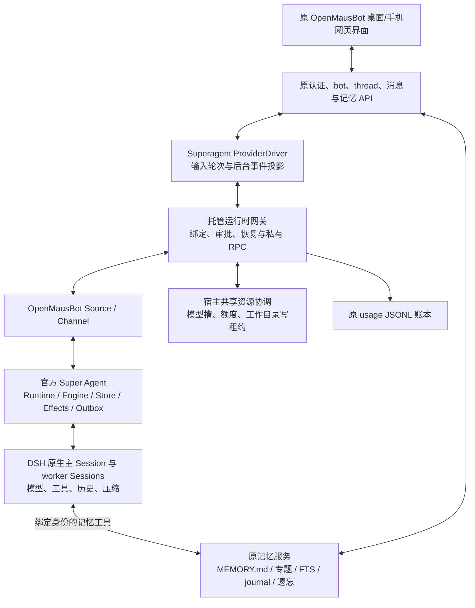

# 原 OpenMausBot + 官方 Super Agent：当前架构

更新日期：2026-11-06。本说明对应 `packages/personbot-superagent` 的官方源码接入路径。早期独立 Personbot 工作台和自有 supervisor 的说明保存在 [历史架构](archive/personbot-architecture-current-before-official.zh-CN.md)；旧阶段验收记录不能作为本路径的验收证明。

## 执行链

原 `App`、Shell、侧栏、聊天、设置和记忆管理仍是产品入口。必要的模型设置放在原设置中。新的 driver 只把原接口接到官方运行时，投影消息和审批事件；它不实现模型循环或另一套任务监督器。

## 官方源码和执行进程

内置的是固定版本的官方 Super Agent 源码及其个人场景适配，执行时启动受本服务管理的 DSH 子进程。当前没有“填写任意外部 DSH 网关 URL”的接入模式，也没有把 DSH 内核复制进原服务进程。

| 项目 | 当前实现 |
|---|---|
| 官方源码 | `packages/personbot-superagent/upstream`，固定 commit `8c32a9dc5d72c033816c6a8110b37f40cf94fba4` |
| 实际加载 | `src/plugin.ts` 直接构造上游 `Runtime`，复用其 Engine、Store、Sessions、DshExecutor、Effects、Outbox |
| DSH | 锁定 npm `0.2.2-rc.1`；不宣称该制品逐字等同研究 checkout |
| 个人部署 | 在上游增加本机工作目录模式；本模式不要求 GitHub 登录和仓库 push 权限 |
| 原界面接入 | 自定义 OpenMausBot Source/Channel；无需采用上游 Web 面板 |
| 传输 | 服务与其子进程之间的双向 stdin/stdout RPC；不对外开放新的模型管理端口 |
| 并发单元 | 每个 bot/thread/原生上下文分支一个托管 DSH 运行时；其中主 Session 可管理多个 worker |
| 资源回收 | 按需启动，默认最多 8 个子运行时；检查未结束任务、待审批和待投递后才回收空闲实例 |
| 后台恢复 | 服务启动扫描需要恢复的活动绑定，按资源限制和退避唤醒官方运行时，不依赖新聊天输入 |
| 宿主协调 | 同一用户的托管网关默认共享 `~/.personbot-host`，限制模型调用和工作目录写窗口 |

上游是研究原型。当前适配保留官方核心，而不是保证所有上游渠道、管理页面和部署假设原封不动适用个人产品。具体修改应与包内来源及补丁说明一起审阅。

## 数据归属

| 数据 | 唯一权威方 | 产品如何使用 |
|---|---|---|
| bot、产品 thread、可见消息、已读、权限 | 原 OpenMausBot Store/消息数据库 | 原界面和手机接口继续读取 |
| 主模型与 worker 的原生上下文、工具结果、压缩 | DSH Session 持久化 | 继续原生会话，不逐轮重放产品消息 |
| Trigger、Decision、Ticket、Assignment、任务报告和发送状态 | 官方 Super Agent Store/Effects/Outbox | 按官方事件投影；任务资料按需查询 |
| 个人事实、偏好、专题笔记、遗忘抑制、变更日志 | 原 OpenMausBot 记忆服务 | 原管理界面和 native memory tools 共同使用 |
| bot/thread/context、固定工作目录、原请求授权、审批与任务投影、投递/用量回执 | 适配层 `bindings.sqlite` | 连接官方任务与原产品，不另建任务判定或个人事实库 |
| 宿主模型槽、写租约、已入场请求数与累计额度 | `host-resources.sqlite` | 跨托管网关协调资源；不取代原用量账本 |
| 主助手、worker、记忆维护的实际 token 与已知费用 | 原 `usage/YYYY-MM.jsonl` | 原用量页面和费用统计继续读取，按原生调用 ID 去重 |

原消息数据库保存产品可见投影；DSH 保存实际执行历史。这两份数据职责不同。worker 的内部文本不会直接作为第二份答案写入聊天；来源 Outbox 负责正式回复。

## 输入、任务与审批

输入轮次只负责当前输入框和原忙碌状态。官方 Ticket/Assignment 独立负责持久工作。审批请求再以 decisionId 绑定其 request、ticket、Agent、工具调用和授权版本。输入轮次结束或用户开始另一轮，不会自动删除前一任务仍有效的审批入口。

这不表示同一线程的所有输入都独立并行。官方 Intake/followupOwners 可以把后来的消息作为当前任务的补充，输入轮次可能等待 worker 交还；独立线程或上下文可以分别执行，仍受宿主资源限制。

driver 与原消息投影对后台审批、问题和任务通知使用独立通道，核对当前分支、持久来源和授权，不借用正在输入的另一轮。审批卡带原来源，重复事件不会重复写卡。回答时网关重新检查审批、原生子进程归属、任务是否结束和授权版本；Stop、分支退出、工具取消或原生进程退出使对应审批失效。进程重启后旧 decisionId 不能批准重新出现的工具调用；官方恢复后提出的新审批使用新 ID。

原 Stop 按钮在可确定 request 时停止该请求对应的工作。后端还分别提供停止一个 ticket 和停止会话全部活动上下文的入口；这些范围不再隐式混用。API 与具体限制见[加固设计](personbot-review-hardening.zh-CN.md)。

## 会话、工作目录、分支与恢复

产品 botId/threadId 保留，原生续接游标使用 `omb-superagent:<contextId>`。每个 context 固定绑定规范化的真实工作目录。符号链接别名指向同一目录时可继续；实际目录变化时 driver 创建新的 workspace context，并显示执行目录，网关拒绝直接把同一个旧 context 改到新目录。

目录变化保留原目录中已经存在的后台工作；它们继续使用原工作目录、任务来源和授权。编辑、回退或明确分支重建则退出旧活动分支，拒绝其后续记忆写入、消息投影和自动恢复。目录变化与分支回退是两种不同的上下文转换。

首次进入新原生上下文时，只把当前可见路径的有界历史标为参考材料。旧 Claude/Codex 的内部会话游标不能恢复成 DSH Session。完整长期记忆不复制进永久 system section；需要时由工具读取当前权威内容。

同一原生上下文的主 Session 和 worker 持久数据保留。网关启动时扫描未结束任务、未完成入场、Stop 意图和未确认投递，按并发上限和退避规则唤醒对应官方运行时；它只管理进程生命周期，任务恢复仍由官方 Runtime 执行。没有待办的历史绑定继续按需加载，不会全部启动。回收还检查官方活动快照；输入框空闲本身不构成回收资格。

官方 Outbox 必须等原消息库成功提交后才确认发送；原消息行与命令回执在原 SQLite 事务内提交，同一 Outbox ID 重试不会再添加一条消息。首次尝试即固定投递的原请求映射，后来的任务补充不会改变旧消息的来源。任务追问可以释放当前输入框，后来的最终结果仍通过持久请求来源投递。

这项消息去重不等于任意文件修改、外部工具副作用都具有跨进程恰好一次保证。子进程意外退出会结束原界面的忙碌状态、使旧审批失效；用户仍可通过原 Stop 取消恢复后的持久任务。

## 记忆统一

详见 [记忆设计](personbot-memory-design.zh-CN.md)。原事实库继续负责事实；官方任务库继续负责任务资料。检索结果明确标注 `omb.memory`、`omb.conversation` 或官方任务来源，避免报告与事实混淆。

记忆请求携带真实 request、用户消息、Agent 角色和授权版本，宿主从持久请求重建并重新检查。worker 默认只读；写入候选交给主助手。`remember` 只保留有真实用户证据的原陈述，不能用一条真实引用证明任意改写；`forget` 还要求该用户消息明确要求遗忘准确的目标。Stop 后旧授权不能写入。

有效 `forget` 复用原笔记删除、About me 清理和遗忘墓碑。遗忘阻止原记忆的主动召回和自动学回，不表示物理抹除历史聊天、journal 或 DSH 日志。

原 About me 也通过按需检索和 `memory_read("about-me")` 读取当前资料，保留 `omb.profile` 来源；资料编辑无需重建原生会话。仅允许本人直接会话访问这个端口。原自动记忆维护继续使用原规则，模型文本生成端口换成无工具的 DSH 调用；维护任务不会获得工作区执行工具。

## 共享目录和费用

宿主协调器按真实工作目录分配互斥写租约。Git 项目按仓库根目录协调，非 Git 目录还检查父子路径重叠；使用同一协调目录的跨会话、跨网关参与同一规则。当前保守覆盖 worker 的完整执行与测试窗口，安全的纯读取不会被当成独立写工具，但 worker 整体可能因此排队。主助手的原生变更工具也参与写协调。

活动写窗口的原生进程或宿主异常退出、被强制关闭时，相关目录进入持久写入隔离。重启不会自动解除它，也不会凭不可靠 PID 猜测外部工具已经结束；新的重叠写工作暂停，不需要写窗口的模型读取可继续。原设置显示隔离目录，owner/admin 先核查相关外部进程与文件，再通过明确确认解除。这个流程是保守暂停和人工核查，不证明原生工具没有孤儿进程或任意副作用恰好一次。

这是托管任务之间的协调，不是操作系统文件沙箱，也不阻止用户或未接入协调器的外部程序修改文件。每任务 Git worktree、显式合并和非 Git 产物交付仍属于后续阶段。

主助手、worker 和无工具记忆维护的每次实际模型调用都经过宿主模型槽。累计调用数、token 和可验证美元额度可分别限制，达到后拒绝新的调用；已经入场的调用可以完成，最终使用量可能超过 token/费用阈值。未知价格保留为空并报告未定价数量，不能作为零费用；配置美元硬限制而出现未定价调用时，协调器暂停后续调用。

实际 usage 经稳定 ID 写入原账本，未确认投影会重试。原用量页面可读取这些记录，原每输入轮次的占位记账在官方模式停用。跨原账本与 Store 计数不构成一个原子事务；账本是用量权威，详见[加固设计](personbot-review-hardening.zh-CN.md)。

单任务用量接口按原账本的 bot/thread/context/ticket 严格汇总独占用量，包含缓存写入；另列同一 context 中未分配给 ticket 的共享开销，包括主助手路由。共享部分明确标为非独占、不计入该任务，多个任务查询中的同一共享池不能重复相加。各部分的未定价调用使其完整 `costUsd` 为空，已知部分另列。原模型设置显示实际模型槽、排队、token、额度和未定价状态，并可手动刷新。

## 插件、手机与其他原功能

DSH 插件机制可用于继续扩展本机 profile。当前 App 没有插件市场或安装管理入口；托管 profile 禁用运行中的插件管理工具。不能把“DSH 支持插件”描述为“原 App 上所有 Connected Apps 已自动变成 DSH 工具”。新的桥接目前覆盖聊天、原记忆、原生工具、审批、提问与停止；原来的浏览器/桌面/供应商专属工具需要逐项接入。

原手机网页布局、认证和配对基础保留，聊天接口沿用原协议。桌面宽度与手机宽度的浏览器验证、真实手机扫码/配对、已发布原生 companion 的验证是三项不同的工作。已保存的[集成验收记录](verification/personbot-official-superagent-2026-11-06.md)保留其原有范围，本轮加固另以最终发布记录为准。

旧自动化、旧多引擎执行器和早期自有 supervisor 不在本模式执行。后端能力清单由原设置展示，明确原 Connected Apps、电脑工具、自动化、插件安装器和外部网关是否可用于当前运行时。原 UI 中的保留页面不代表它们的执行能力已经迁到 DSH。早期实验包和数据保留，当前不运行双重监督、双重事实写入。
