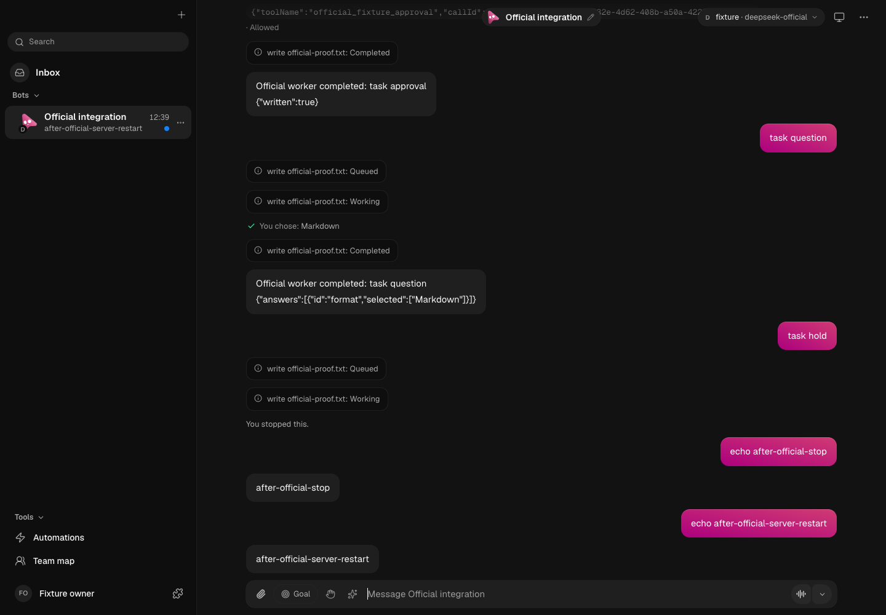
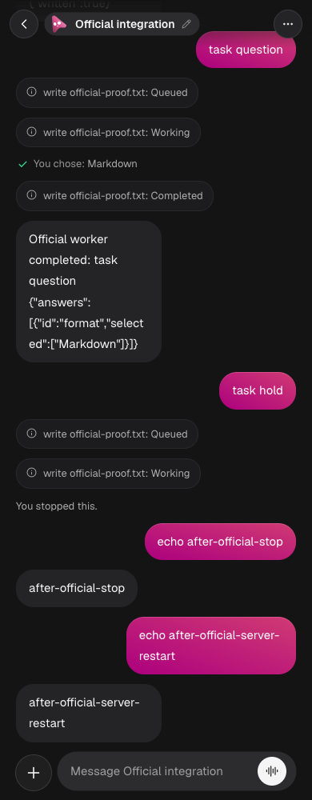
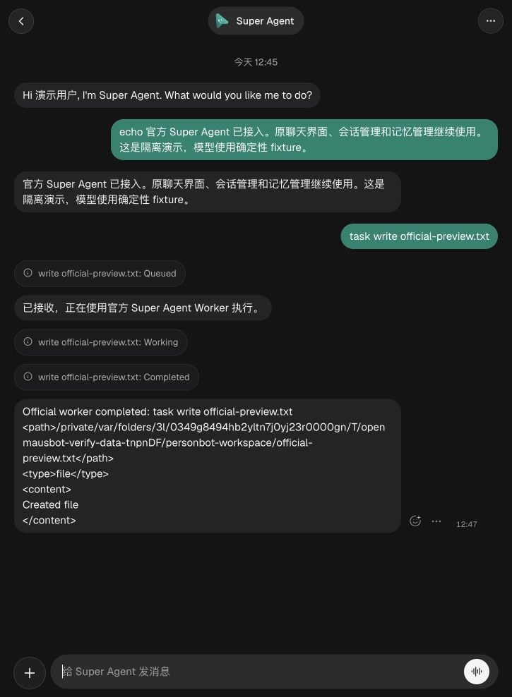

# 原 App、官方 Super Agent 与统一记忆验收

日期：2026-11-06，macOS arm64。运行环境为 Node.js 26.10.0、pnpm 10.33.0、锁定的 DSH 0.2.2-rc.1。本文只记录当前官方源码接入路径；早期 W0–W6 的独立工作台与自建 supervisor 验收仍是历史记录。

本次使用真实的原 App、原 Store/SQLite/FTS/记忆服务、内置的上游 Super Agent Runtime 及本机 DSH 主/worker Session。模型通过确定性 fixture 发出原生工具调用，未使用真实模型账号。每个变更测试使用临时 HOME、OMB_DATA_DIR 和 DSH_HOME；没有向用户运行中的 App 或个人数据发送变更请求。

## 实际实现

- 保留原 App、侧栏、聊天、设置和记忆管理入口。在原设置中增加 Super Agent 模型和密钥配置。
- `packages/personbot-superagent/src/plugin.ts` 实际构造固定上游 Runtime；Engine、Store、Sessions、DshExecutor、Effects、Outbox 继续由上游实现。
- 官方模式只注册 `dsh-superagent` 执行器，停用旧多引擎及早期自建 supervisor 的并行执行。
- 原个人记忆为唯一事实来源。原 About me 按需实时读取；原对话检索标为历史；官方任务资料和 DSH 执行上下文各自保留。
- Source Outbox 经过私有 RPC 等待原消息与回执事务提交；稳定来源 ID 支持重投去重。普通回答、任务最终结果和追问分别保留用途。
- 每个 bot/thread/context 按需恢复托管运行时。Stop、分支退出、过期审批和已排队旧候选均检查当前身份。

架构与精确边界见[当前架构](../personbot-architecture-current.zh-CN.md)、[记忆设计](../personbot-memory-design.zh-CN.md)和[上游来源及补丁](../../packages/personbot-superagent/UPSTREAM.md)。上游明确称其为研究原型，不是正式 DeepSeek 产品或生产就绪软件。

## 检查命令与结果

| 检查 | 实际结果 | 记录 |
|---|---|---|
| `pnpm personbot:official:test` | Node 36/36；Vitest 40/40，零失败、零跳过 | [聚合日志](evidence/personbot-official-superagent-2026-11-06/checks/official-tests.log) |
| 官方上游 Engine、Store、Outbox、Delivery 四套测试 | 152/152，含本地整合新增的五个回归 | [上游日志](evidence/personbot-official-superagent-2026-11-06/checks/core-upstream.log) |
| `pnpm personbot:official:e2e` | 两文件、三场景全部通过 | [端到端日志](evidence/personbot-official-superagent-2026-11-06/checks/e2e.log) |
| 增强原 App 截图检查 | 完整场景再次通过；等待自动重连及原侧栏动画完成 | [最终浏览器日志](evidence/personbot-official-superagent-2026-11-06/checks/product-final.log) |
| `pnpm typecheck && pnpm personbot:typecheck` | 原 App/server、父运行时和上游插件编译域通过 | [类型日志](evidence/personbot-official-superagent-2026-11-06/checks/typecheck.log) |
| `pnpm lint` | 全仓严格检查通过 | [lint 日志](evidence/personbot-official-superagent-2026-11-06/checks/lint.log) |
| `pnpm personbot:build` | 原类型检查、官方运行时类型检查及专属 Vite 构建全部通过 | [构建日志](evidence/personbot-official-superagent-2026-11-06/checks/build.log) |
| 专属产物构建后的启动器验收 | 6/6，含两个真实启动场景，零跳过 | [启动日志](evidence/personbot-official-superagent-2026-11-06/checks/launcher.log) |

聚合检查包含实际 native DSH 15 项、原记忆 17 项、原消息投递 4 项。Vitest 部分覆盖 driver、模式、设置、控制工具及启动器；专属前端产物交付后的启动验收另列在下方，避免把构建前的检查作为最终入口证明。

## 原界面连续会话

测试入口为 `scripts/testing/superagent-product.e2e.test.ts`，挂载原 `src/App.tsx`，不是另一个工作台。在同一原会话依次验证：

1. 仅查看页面与状态不启动 DSH；实例列表只有官方执行器。
2. 原侧栏选 bot，原输入框发送，原消息区显示正式回复；worker 文本不另写成重复答案。
3. 原记忆 API 编辑专题笔记，native 记忆工具读到同一内容。
4. 原 About me 从绿自行车改为蓝自行车，同一原生会话下一次检索立即读取新资料。
5. `remember` 写回原 MEMORY.md 和 journal；`forget` 删除有效事实并过滤旧聊天的检索命中。
6. 官方 Engine 创建 worker，实际 DSH 文件工具写入隔离工作区；worker 检索相同的原记忆。
7. 原审批接口先拒绝、后允许准确的 native 请求；旧审批不能批准新任务。
8. 原问题卡把选项答案送回对应 native question。
9. 原 Stop 取消已在工作的任务，随后同一会话正常完成新请求。
10. 重启服务后原消息保留，沿用同一官方绑定与持久任务库继续；原浏览器自动恢复并显示重启后的新回答。
11. 原界面在 1440 与 390 像素宽度下无横向页面溢出，输入框完整处于视口内。截图等待原侧栏退出动画完成，未修改产品布局。

[完整浏览器证据](evidence/personbot-official-superagent-2026-11-06/product/evidence.json)包含 API 调用、原消息、官方 Trigger/Ticket/Outbox、绑定/请求/投递回执及最终页面状态。临时运行数据已随 fixture 关闭删除。

## 崩溃、追问与投递恢复

`scripts/testing/superagent-recovery.test.ts` 的两个隔离场景均通过：

- [任务追问与恢复](evidence/personbot-official-superagent-2026-11-06/recovery-attention/evidence.json)：官方任务提出问题，原界面释放输入轮次；用户补充后同一 ticket 产生最终结果；重启不重复投递。
- [实际 SIGKILL 与 Stop 恢复](evidence/personbot-official-superagent-2026-11-06/recovery-crash/evidence.json)：native 审批期间终止准确的托管子进程，原忙碌状态释放、旧审批失效；原 Stop 恢复并结束持久旧任务；继续输入与服务重启仍保留身份和消息。

这些检查验证官方状态恢复与产品消息去重，不证明任意外部工具的副作用具有跨进程恰好一次语义。

## 本轮发现并保留的回归

连续产品测试实际发现了短测试未覆盖的问题，失败证据保留在本目录：

- [Stop 后旧候选重新创建任务](evidence/personbot-official-superagent-2026-11-06/regressions/queued-request-after-stop-before-fix.json)：官方主 Session 中已排队的旧 trigger 可以绕过首次 Intake 检查。现在 Evals 的实际评估/路由及 Tickets 的附加入口重新检查当前 Source scope；撤销的 held eval 持久拒绝，有效成员重新入队。另修正 human-stopped ticket 的旧订阅不能据此取得新回答的所有权。上游回归与实际长会话均验证 Stop 后新输入不再复活旧任务。
- [FTS 高亮绕过多词遗忘](evidence/personbot-official-superagent-2026-11-06/regressions/fts-forget-before-fix.json)：`[concise] [architecture] [reviews]` 把原短语拆断。现在对话命中检查当前活动路径中的完整原文，笔记命中检查当前原始文件；呈现高亮不参与墓碑判断，真实方括号的原有语义保留。真实 SQLite/FTS 回归还验证 daily log 不冒充 durable-note。
- 原 App 截图曾截到侧栏收起动画的中间状态。最终检查等待侧栏完全离开手机视口再截图，未为截图改动 UI。
- 最终启动审计发现根 `dist` 可误用旧 W6 界面。当前官方产品独立使用 `dist-personbot`，构建和服务选择相同目录。

## 专属构建与启动

日常入口为 `pnpm personbot:start`，按需调用 `pnpm personbot:build`。构建先检查原产品及官方运行时类型，再通过 Vite 输出到 `dist-personbot`。`--skip-build` 只使用该目录；缺失时明确拒绝启动，不回退到根 `dist`。

正常首次启动和无密钥隔离演示使用相同专属产物。构建后的启动测试 6/6 通过，比较返回 HTML 与该产物，并检查准确的服务/DSH 进程关闭、演示数据清理、普通数据保留及缺少凭据时不提前启动 DSH。[演示启动与关闭证据](evidence/personbot-official-superagent-2026-11-06/launcher-demo/evidence.json)和[首次普通启动证据](evidence/personbot-official-superagent-2026-11-06/launcher-first-use.json)均来自临时隔离目录。

构建成功，保留了原前端的 chunk 体积提示、CSS `::highlight` 优化器兼容提示及依赖注释提示；没有把这些提示称为编译错误，也没有为清除提示改动原 UI。

最终另以 `node scripts/personbot-start.ts --demo --skip-build --port 21380` 启动可交互演示，静态 HTML 与 `dist-personbot/index.html` 字节一致。实际在内置浏览器的原输入框发送 `task write official-preview.txt`，官方任务显示 Queued、Working、Completed，DSH 在隔离目录写入真实文件。最终核对保留了[产物 hash、文件内容、运行状态与消息](evidence/personbot-official-superagent-2026-11-06/preview.json)。此演示仅在该启动进程继续运行时可用，模型仍为确定性 fixture。

## 验收范围

已验收的是本机源码模式、真实官方/native 执行链及确定性模型下的原聊天/记忆/审批/问题/Stop/恢复。未把下列事项计为完成：

- 真实模型账号的质量、网络与工具可靠性。
- 任意外部 DSH gateway 连接器、App 内插件安装管理。
- 原全部 Connected Apps、浏览器、桌面与供应商专属工具的 DSH 挂载。
- 旧自建 supervisor 的任务数据库迁移。
- 实际手机扫码配对、发布版原生 companion、桌面安装包及其他操作系统。
- 每个 worker 的独立 Git worktree；当前本机 worker 共享所选工作目录。

普通 `forget` 沿用原产品语义，过滤有效记忆、召回和自动学回；不会物理删除旧聊天、journal 或原生执行历史。
